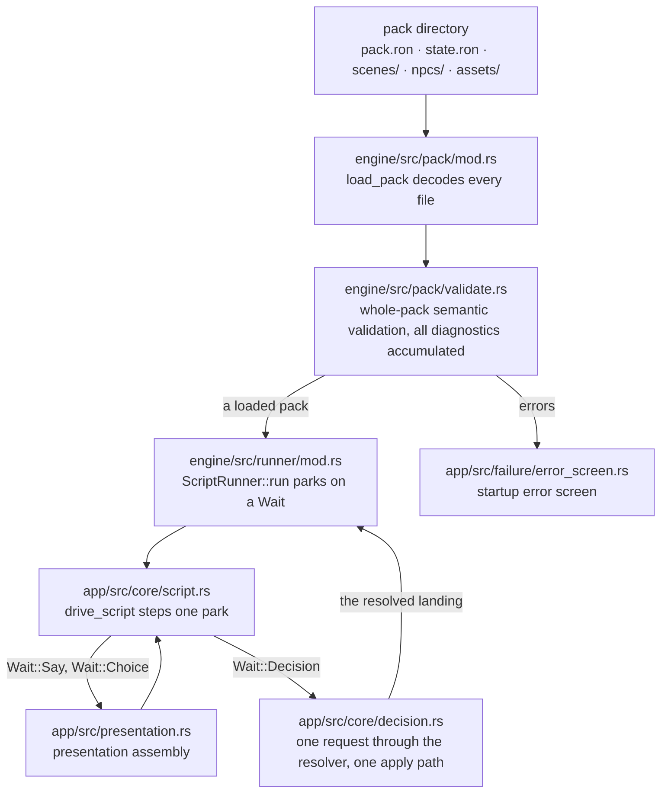
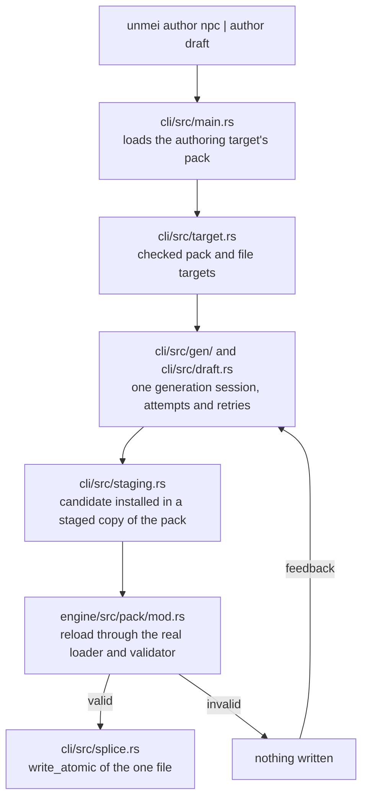

# Architecture — crate boundaries, data flow and the contract map

This page routes you to the code you are about to change. It shows which crate owns what, how a pack reaches the screen, how a command reaches a file and where each contract lives. It states no contract of its own, except the roles, names and boundaries of the three crates in [Crate boundaries and invariants](#crate-boundaries-and-invariants). Terms such as content pack, Decisions, decision point and Notice are defined in [`GLOSSARY.md`](../GLOSSARY.md).

## Crate boundaries and invariants

The root [`Cargo.toml`](../Cargo.toml) lists three workspace members: `engine`, `cli` and `app`. The player and the CLI both build on the engine. The engine builds on no other member. This section owns each crate's role, package name, binary name and boundary. Other pages link here instead of restating them.

### `engine/` — package `unmei-engine`, no binary

- **Role.** The shared content core. It provides:
  - pack loading and whole-pack validation ([`engine/src/pack/mod.rs`](../engine/src/pack/mod.rs), [`engine/src/pack/validate.rs`](../engine/src/pack/validate.rs));
  - the `.unmei` parser;
  - the headless script runner ([`engine/src/runner/mod.rs`](../engine/src/runner/mod.rs));
  - save and load ([`engine/src/save/mod.rs`](../engine/src/save/mod.rs));
  - the read log;
  - the Decisions wire layer (`engine/src/decision/`).
- **No binary.** The manifest declares no `[[bin]]`, so the crate ships no executable ([`engine/Cargo.toml`](../engine/Cargo.toml)).
- **Boundary: stays free of Bevy and of rendering, windowing and audio.** The CLI is a terminal program, and the player and the CLI must run the same pack rules. So Bevy, rendering, windowing and audio code cannot leak into the crate that carries those rules ([`engine/src/lib.rs`](../engine/src/lib.rs)).
- **Enforcement.** CI checks the boundary before `fmt`, Clippy and the tests. The `check` job in [`.github/workflows/check.yml`](../.github/workflows/check.yml) runs [`scripts/check-invariants.py`](../scripts/check-invariants.py). The script rejects any Bevy package in the engine's resolved dependency graph, in every feature and target selection. To run it locally, follow [`CONTRIBUTING.md` § Local repository invariant checks](../CONTRIBUTING.md#local-repository-invariant-checks).
- **Feature `network`.** It is off by default. It adds the OpenRouter Decisions client ([`engine/Cargo.toml`](../engine/Cargo.toml)). The CLI and the player both enable it ([`cli/Cargo.toml`](../cli/Cargo.toml), [`app/Cargo.toml`](../app/Cargo.toml)).

### `cli/` — package `unmei`, binary `unmei`

- **Role.** The authoring CLI. `unmei author npc` generates a decision config, and `unmei author draft` drafts scene prose. Each command validates the result and splices it into one file of a pack ([`cli/src/main.rs`](../cli/src/main.rs), [`cli/src/runner.rs`](../cli/src/runner.rs)). The package name and the binary name are both `unmei` ([`cli/Cargo.toml`](../cli/Cargo.toml)).
- **Boundary: its library half is an internal implementation detail.** The modules live in a library so the binary's tests can drive them directly. Nothing there is a supported API, and the project can rename, change or remove any item in a patch release, with no stability promise ([`cli/src/lib.rs`](../cli/src/lib.rs)).

### `app/` — package `unmei-app`, binary `unmei-play`

- **Role.** The Bevy player. It owns windowing, rendering, audio, input, presentation and the Decisions calls it starts at a decision point ([`app/src/composition.rs`](../app/src/composition.rs), [`app/src/presentation.rs`](../app/src/presentation.rs)). The package is `unmei-app` and the binary is `unmei-play` ([`app/Cargo.toml`](../app/Cargo.toml)).
- **Boundary: unpublished.** `app/Cargo.toml` sets `publish = false`, so Cargo refuses to publish the player to crates.io. The engine and the CLI carry no such flag.
- **Library.** The crate also exposes a library, `unmei_app`. The shipping-schedule test ([`app/tests/shipping_schedule.rs`](../app/tests/shipping_schedule.rs)) uses it to build the production schedule without a window.

## Data flow

This section shows two flows, main steps only. Each node names the module that owns it. The contracts those modules implement are in the [contract map](#contract-map).

### Loading a pack and playing it

The engine decodes and validates a pack directory. A valid pack goes to the script runner, and a pack with errors goes to the startup error screen. The player steps the runner to each Wait. A say or choice Wait goes to presentation and back to the stepper. A decision Wait goes through one resolver request, and the resolved landing returns to the runner.

### Authoring: from a command to a written file

An authoring command loads the target's pack and checks the file target. One generation session produces a candidate, which the CLI installs in a staged copy of the pack. The engine's loader and validator reload that copy. A valid candidate is written as the one file. An invalid candidate writes nothing, and the feedback returns to the generation session.

## Contract map

Contracts own every behavioral fact. [Guide](../GLOSSARY.md#distribution) pages and sanctioned copies present a contract and link its owner. A sanctioned copy is a text allowed to repeat a contract, and it names the contract section it copies. The sanctioned copies are the controls table in `README.md`, `packaging/player-README.md` and `packaging/author-README.md`. No other text repeats a contract.

This table lists each contract and the pages and copies that present it. The contract-map checkbox in the pull request template (`.github/PULL_REQUEST_TEMPLATE.md`) points a contributor here to update those presentations when a change alters a contract.

In the Presented in column, each name is a file path in a code span, not a link. `README.md` is this repository's public README, and `docs/guide/*` are the Guide's pages. A dash (`—`) means that no page or copy presents the contract, so the file in the first column is the only place it lives.

| Contract | Owns | Presented in |
|---|---|---|
| [`content-format.md`](content-format.md) | pack layout, the `.unmei` dialogue DSL, decision configs and decision points, transitions, manifest and state | `docs/guide/format-overview.md`, `docs/guide/write-your-first-pack.md`, `packaging/author-README.md` |
| [`author-cli.md`](author-cli.md) | `unmei author npc`: command surface, the one write unit, the validation gate, provider configuration, staged validation, authoring-target confinement | `docs/guide/install-the-cli.md`, `docs/guide/author-with-the-cli.md`, `packaging/author-README.md` |
| [`author-cli-drafting.md`](author-cli-drafting.md) | `unmei author draft`: command surface, generation unit, the two-layer gate, provider output, regeneration policy | `docs/guide/write-your-first-pack.md`, `docs/guide/author-with-the-cli.md`, `packaging/author-README.md` |
| [`runtime-hardening.md` § Save slots](runtime-hardening.md#save-slots) | the sibling slot files, the version floor, exact-resume load | `docs/guide/play-the-demo.md`, `packaging/player-README.md` |
| [`runtime-hardening.md` § Menu overlay](runtime-hardening.md#menu-overlay) | the Esc-toggled menu overlay, its card grid and what it offers | `docs/guide/play-the-demo.md`, `packaging/player-README.md` |
| [`runtime-hardening.md` § Audio settings](runtime-hardening.md#audio-settings) | volumes, ranges, defaults and where they persist | — |
| [`runtime-hardening.md` § Player comfort](runtime-hardening.md#player-comfort) | the shipped controls, text speed, auto mode, fullscreen | `README.md`, `packaging/player-README.md` |
| [`runtime-hardening.md` § Text skip](runtime-hardening.md#text-skip) | seen skip, force skip and what cancels each | `README.md`, `packaging/player-README.md` |
| [`runtime-hardening.md` § Runtime failure posture](runtime-hardening.md#runtime-failure-posture) | the postures, the Notice, the startup error screen, the session log | `docs/guide/troubleshooting.md` |
| [`runtime-hardening.md` § Provider seam](runtime-hardening.md#provider-seam) | the narrow resolver the app runs Decisions through | `docs/guide/live-decisions.md` |
| [`runtime-hardening.md` § Read log](runtime-hardening.md#read-log) | read marks, their version equality and their file | `packaging/player-README.md` |
| [`runtime-hardening.md` § Monitor](runtime-hardening.md#monitor) | the developer log drawer, its capture, reader and layout | — |
| [`runtime-hardening.md` § Dev mode](runtime-hardening.md#dev-mode) | the one app-lifetime dev gate and the `--dev` launch grammar | — |
| [`runtime-hardening.md` § Menu and live-session transitions](runtime-hardening.md#menu-and-live-session-transitions--ownership-design), [§ Presentation surfaces](runtime-hardening.md#presentation-surfaces--decided-partition), [§ Shipping composition](runtime-hardening.md#shipping-composition--proof-gated-shared-owner) | who owns a transition, a presentation surface and the shipped plugin selection | — |
| [`title-and-menu.md` § Decisions settings](title-and-menu.md#decisions-settings) | the key row, key validation, and where the key is stored and applied | `docs/guide/live-decisions.md`, `packaging/player-README.md` |
| [`title-and-menu.md`](title-and-menu.md) | the title's states, layout and type system, the Gallery and the Timeline | `docs/guide/play-the-demo.md`, `packaging/player-README.md` |
| [`decisions-scale.md`](decisions-scale.md) | why batching and prefetch wait, the flip trigger, the rejected cache | — |
| [`release-certification.md`](release-certification.md) | candidate identity, the release set and its blocking evidence, artifact custody, staged publication | — |
| [`slice-save-audio.md`](slice-save-audio.md) | the slice's persisted payload, exact-resume semantics, the audio posture | — |
| [`testing.md`](testing.md) | the test-selection policy: what each crate tests, replacing an external dependency, the validation gates and the shipped-path evidence | — |
| [`testing-behavioral-protection.md`](testing-behavioral-protection.md) | the required behavioral protections and the evidence for each | — |
| [`testing-coverage-evidence.md`](testing-coverage-evidence.md) | what a coverage claim must measure, report and retain | — |
| [`testing-human-smoke.md`](testing-human-smoke.md) | the human smoke checklist and its evidence boundary | — |
| [ADR 0001 — RON for the pack's structured content](adr/0001-ron-for-structured-content.md) | RON is the pack format; LLM-facing JSON is converted at the CLI boundary | — |
| [ADR 0002 — Line-oriented dialogue DSL without conditionals](adr/0002-line-oriented-dsl-without-conditionals.md) | no indent stack; conditionals excluded there and added by ADR 0004 | — |
| [ADR 0003 — Decision points: judgment in data, flow in script](adr/0003-decision-points-judgment-in-data-flow-in-script.md) | the config in the NPC file, one `decide` line in the scene | — |
| [ADR 0004 — Conditionals in the dialogue DSL](adr/0004-conditionals-in-the-dialogue-dsl.md) | flat `if`/`else`/`endif`, and a state key's declared kind is fixed | — |
| [ADR 0005 — noul and score question types land on labels](adr/0005-noul-and-score-question-types.md) | two question types, each still landing the script on a label | — |
| [ADR 0006 — Four sibling save slots with an additive version floor](adr/0006-save-slots-on-disk-format-and-version-policy.md) | slot files written atomically, a version floor that refuses zero and newer | `docs/guide/play-the-demo.md`, `packaging/player-README.md` |
| [ADR 0007 — A sectioned, unversioned settings file beside the pack](adr/0007-settings-file-beside-the-pack.md) | one preferences file, defaults applied field by field | `packaging/player-README.md` |
| [ADR 0008 — Player-first failure posture](adr/0008-player-first-failure-posture.md) | failures classified by what the player can do next; one Notice | — |
| [ADR 0009 — One narrow decision-resolver seam without a vendor abstraction](adr/0009-decision-resolver-seam.md) | no vendor abstraction; one narrow resolver trait | — |
| [ADR 0010 — Credentials live in a user-level file](adr/0010-credentials-live-in-a-user-level-file.md) | the key in one user-level plain-text file, never in the pack | `docs/guide/live-decisions.md`, `packaging/player-README.md` |
| [ADR 0011 — The read log as a third persistence class](adr/0011-read-log-as-a-third-persistence-class.md) | read marks keyed by scene and authored line, strict version equality | `packaging/player-README.md` |
| [ADR 0012 — Menu decisions and live-session recipes have separate owners](adr/0012-menu-and-live-session-transition-ownership.md) | navigation stays in the menu; entry and replacement recipes in a session module | — |
| [ADR 0013 — One realization owner per presentation surface](adr/0013-presentation-surface-partition.md) | a thin assembly coordinator over one owner per surface | — |
| [ADR 0014 — CLI diagnostics are categorical; terminal content masks known credentials](adr/0014-cli-diagnostics-and-terminal-credential-safety.md) | fixed diagnostic categories; configured keys masked in output | — |
| [GLOSSARY § Content & packs](../GLOSSARY.md#content--packs) | content pack, manifest, default pack, entry scene, declared scene order | `docs/guide/format-overview.md`, `packaging/author-README.md` |
| [`GLOSSARY.md` § Scripts](../GLOSSARY.md#scripts) | scene, say-line, run, label, player choice, conditional, state map | `docs/guide/write-your-first-pack.md`, `packaging/author-README.md` |
| [`GLOSSARY.md` § Saving](../GLOSSARY.md#saving) | sidecar, save slot, autosave, legacy save, unreadable slot | `docs/guide/play-the-demo.md`, `packaging/player-README.md` |
| [`GLOSSARY.md` § Reading](../GLOSSARY.md#reading) | read log, visited scene, arrival status, seen skip, force skip | `packaging/player-README.md` |
| [`GLOSSARY.md` § Pause & menu](../GLOSSARY.md#pause--menu) | menu overlay, presentation pause, input ownership, title, Gallery, Timeline | `packaging/player-README.md` |
| [`GLOSSARY.md` § Failures](../GLOSSARY.md#failures) | Notice, silent degradation, defensive failure and the error screen, beside the dev-mode and Monitor terms | `docs/guide/troubleshooting.md` |
| [`GLOSSARY.md` § Settings](../GLOSSARY.md#settings) | settings file, credential file, text speed, auto mode, Decisions group, key row | `packaging/player-README.md` |
| [`GLOSSARY.md` § Authoring](../GLOSSARY.md#authoring) | draft, preparation failure, terminal mask | `packaging/author-README.md` |
| [`GLOSSARY.md` § Decisions](../GLOSSARY.md#decisions) | NPC, question type, legend, action, decision point, landing key, criterion, fallback, resolver, model pin | `docs/guide/live-decisions.md`, `packaging/author-README.md` |
| [`GLOSSARY.md` § Distribution](../GLOSSARY.md#distribution) | release version, player archive, CLI archive, Guide, format version | `README.md`, `docs/guide/play-the-demo.md`, `packaging/player-README.md` |
